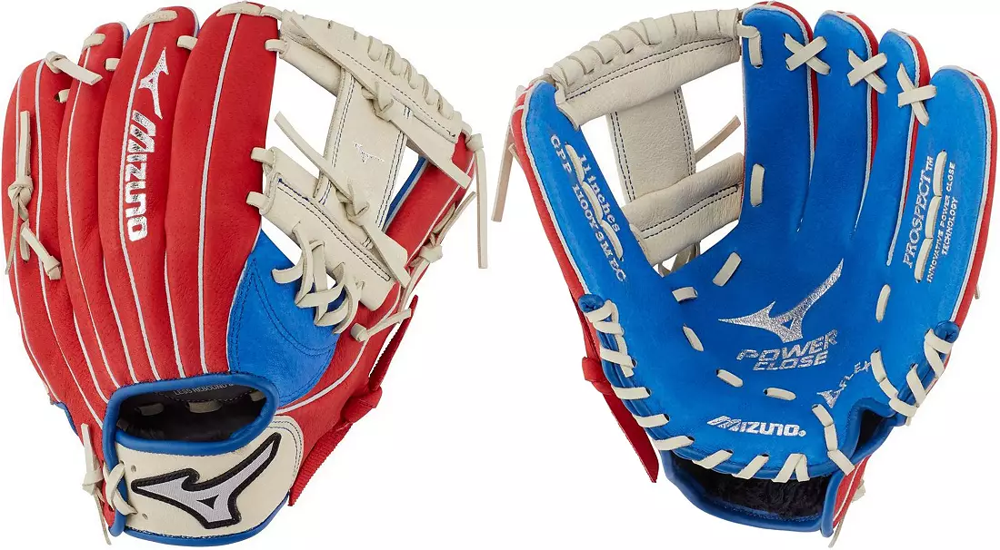
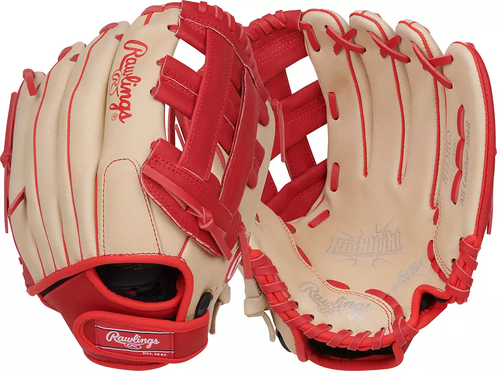
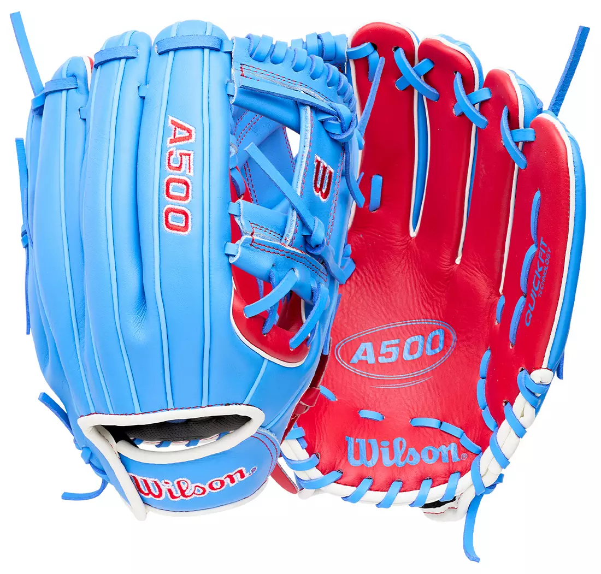

If your child is between an 11-inch and an 11.5-inch baseball glove, start with how they use it. An 11-inch glove is a good first try for a smaller player who spends most of their time in the infield. An 11.5-inch glove is worth trying for a player who rotates between the infield and outfield and can handle the extra length.

The quickest way to decide is to try both with a baseball. See which glove your child can open wide, close around the ball with one hand, and keep secure when they reach down for a grounder.

### Mizuno Prospect PowerClose 11-Inch

Best starting point for a young infielder learning to catch.

Start here if your child’s current glove feels bulky or takes two hands to squeeze. The shorter 11-inch design is a practical size to try at second base or shortstop, and Mizuno’s PowerClose design is intended to help young players close the glove. Have them pick up a few rolled grounders and move the ball into their throwing hand. That tells you more about how the glove feels in play than squeezing it once in the aisle.

[Check the Mizuno Prospect PowerClose 11-inch at DICK’S Sporting Goods](https://www.tkqlhce.com/click-101620676-17023985?url=https%3A%2F%2Fwww.dickssportinggoods.com%2Fp%2Fmizuno-11-youth-prospect-powerclose-series-glove-18mizyprspct11rhybgl%2F18mizyprspct11rhybgl%3Fcjdata%3DMXxOfDB8WXww%26color%3DRed%252FWhite%252FBlue%26camp%3DAFF%3Amediapartner%3ATEXT_link%3A%3A7826100%3AElite%2520Baseball%2520Supply%2520LLC%26cjevent%3D193055d2e60611f1826b01cc0a82b821)

### Rawlings Youth Highlight Series 11.5-Inch

A good first try for a rec player who changes positions.

If your player fields grounders one inning and heads to the outfield the next, the 11.5-inch Highlight gives them a little extra reach. The deciding factor is how securely the glove sits on their hand. Have them point the fingers toward the ground and reach out in front. If the glove slides forward or twists, try the Mizuno or compare it with the Wilson below.

[Check the Rawlings Youth Highlight 11.5-inch at DICK’S Sporting Goods](https://www.kqzyfj.com/click-101620676-17023985?url=https%3A%2F%2Fwww.dickssportinggoods.com%2Fp%2Frawlings-11-5-youth-highlight-series-glove-24rawyhghlght115bbgla%2F24rawyhghlght115bbgla%3Fcjdata%3DMXxOfDB8WXww%26color%3DTan%252FRed%26camp%3DAFF%3Amediapartner%3ATEXT_link%3A%3A7826100%3AElite%2520Baseball%2520Supply%2520LLC%26cjevent%3D2f05bb0ee60611f18265019b0a82b82a)

### Wilson A500 11.5-Inch

Another 11.5-inch option for a developing player who wants a secure fit.

Try the A500 alongside the Rawlings if your child likes the reach of an 11.5-inch glove. Even at the same listed length, the wrist opening and feel can differ. Have your player take a few gentle tosses with each glove. Pay attention to whether they can open the glove all the way, close it around the ball, and find the ball again quickly with their throwing hand.

[Check the Wilson A500 11.5-inch at DICK’S Sporting Goods](https://www.anrdoezrs.net/click-101620676-17023985?url=https%3A%2F%2Fwww.dickssportinggoods.com%2Fp%2Fwilson-11-5-a500-series-glove-26wilmbasefhetdvmvsyq%2F26wilmbasefhetdvmvsyq%3Fcjdata%3DMXxOfDB8WXww%26color%3DRed%252FBlue%252FWhite%26camp%3DAFF%3Amediapartner%3ATEXT_link%3A%3A7826100%3AElite%2520Baseball%2520Supply%2520LLC%26cjevent%3D42b8211be60611f1811701ab0a82b836)

### Which glove would I buy?

For a smaller player learning the infield, I’d try the[ 11-inch Mizuno](https://www.tkqlhce.com/click-101620676-17023985?url=https%3A%2F%2Fwww.dickssportinggoods.com%2Fp%2Fmizuno-11-youth-prospect-powerclose-series-glove-18mizyprspct11rhybgl%2F18mizyprspct11rhybgl%3Fcjdata%3DMXxOfDB8WXww%26color%3DRed%252FWhite%252FBlue%26camp%3DAFF%3Amediapartner%3ATEXT_link%3A%3A7826100%3AElite%2520Baseball%2520Supply%2520LLC%26cjevent%3D193055d2e60611f1826b01cc0a82b821) first. For a player who moves around the field, I’d compare the [11.5-inch Rawlings](https://www.kqzyfj.com/click-101620676-17023985?url=https%3A%2F%2Fwww.dickssportinggoods.com%2Fp%2Frawlings-11-5-youth-highlight-series-glove-24rawyhghlght115bbgla%2F24rawyhghlght115bbgla%3Fcjdata%3DMXxOfDB8WXww%26color%3DTan%252FRed%26camp%3DAFF%3Amediapartner%3ATEXT_link%3A%3A7826100%3AElite%2520Baseball%2520Supply%2520LLC%26cjevent%3D2f05bb0ee60611f18265019b0a82b82a) and [Wilson](https://www.anrdoezrs.net/click-101620676-17023985?url=https%3A%2F%2Fwww.dickssportinggoods.com%2Fp%2Fwilson-11-5-a500-series-glove-26wilmbasefhetdvmvsyq%2F26wilmbasefhetdvmvsyq%3Fcjdata%3DMXxOfDB8WXww%26color%3DRed%252FBlue%252FWhite%26camp%3DAFF%3Amediapartner%3ATEXT_link%3A%3A7826100%3AElite%2520Baseball%2520Supply%2520LLC%26cjevent%3D42b8211be60611f1811701ab0a82b836) and pick whichever stays snug and closes more easily. If both sizes work, let your child field a few grounders and catch a few tosses with each. Buy the one they handle best today.