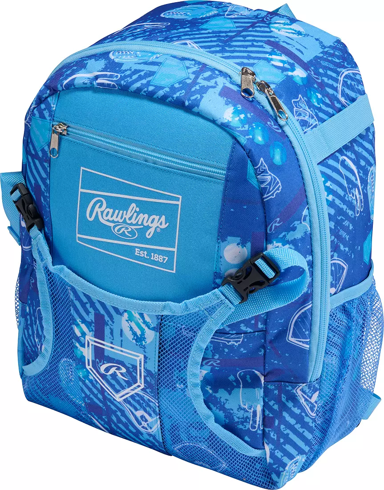
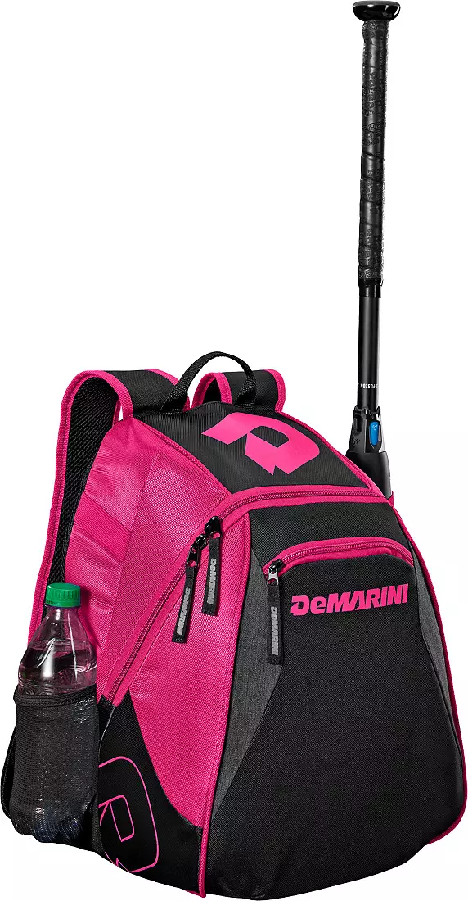
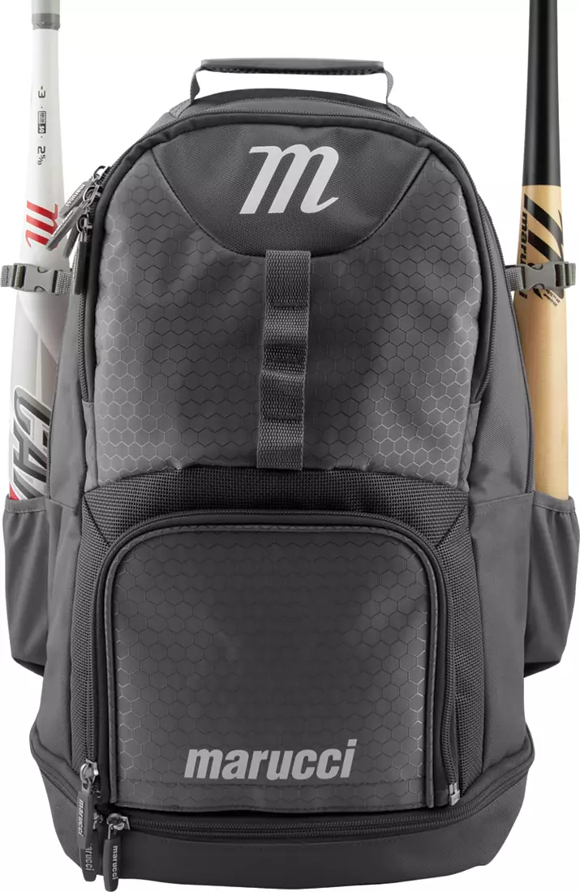

A baseball bag can look plenty big in the store. Then the helmet goes in, the glove gets wedged underneath it, and the muddy cleats end up back in your car.

Buy for the gear your player carries every week. A tee-ball player with one bat and a small helmet has a different packing list from a travel-ball player who brings two bats, cleats, and an extra layer. Here are three bags to compare, starting with the smallest.

### Around $25 — Rawlings Youth Rookie Tee Ball Bat Pack

Best for a first season with a short gear list. At about 16 inches tall, this is the smallest of the three picks. It has two bat storage spots, one main compartment, and a front accessory pocket. DICK’S showed 4.8 stars across 29 reviews on the product page reviewed for this guide. Some of the visible reviews were marked as incentivized, so use the feedback alongside your own fit check.

Before you buy: Put the helmet and fielding glove in together. If the helmet has a face guard or already takes up most of the compartment, bring it to the store and try the next size up too.

[Check the Rawlings Rookie Tee Ball Bat Pack at DICK’S](https://www.tkqlhce.com/click-101620676-17023985?url=https%3A%2F%2Fwww.dickssportinggoods.com%2Fp%2Frawlings-youth-rookie-tee-ball-bat-pack-25rawybaserktbllbtaqy%2F25rawybaserktbllbtaqy%3Fcolor%3DAmericana)

### Around $45 — DeMarini Youth Voodoo Junior Bat Pack

Best for an everyday youth setup. This 17-inch pack has two mesh bat sleeves, a main compartment designed for a helmet and glove, and a fence hook. The hook is handy when your player needs to grab gear from a crowded dugout. DICK’S showed 4.6 stars across 35 reviews. One buyer reported that the bag held up for more than two years but filled up quickly. That’s the trade-off to pay attention to if your kid carries extras.

Before you buy: Load the helmet and glove, then add everything else your player actually brings. If they have to pull the glove out just to get to the helmet, the compact shape may cost them time between innings.

[Check the DeMarini Voodoo Junior Bat Pack at DICK’S](https://www.jdoqocy.com/click-101620676-17023985?url=https%3A%2F%2Fwww.dickssportinggoods.com%2Fp%2Fdemarini-youth-voodoo-junior-bat-pack-19demyvdjr20xxxxxbbg%2F19demyvdjr20xxxxxbbg%3Fcolor%3DPink)

### Around $65 — Marucci F5 Bat Pack

Best for a bigger load or muddy cleats. The reason I’d pay more for the F5 is the bottom storage area for separating dirty gear. If your player routinely stuffs dusty cleats next to their glove, that solves a problem they’ll run into all season. DICK’S listed 157 reviews for the F5 in its bag catalog, the largest review count of these three picks. [DICK’S baseball bag catalog](https://www.tkqlhce.com/click-101620676-17023985?url=https%3A%2F%2Fwww.dickssportinggoods.com%2Fa%2Fteam-bat-bag-0rtz04a.html)

Before you buy: Check that both cleats fit in the bottom section with the rest of the bag loaded. Then put the bats in their sleeves and make sure there’s still a convenient place for the water bottle.

[Check the Marucci F5 Bat Pack at DICK’S](https://www.anrdoezrs.net/click-101620676-17023985?url=https%3A%2F%2Fwww.dickssportinggoods.com%2Fp%2Fmarucci-f5-bat-pack-19mccyf5btpckxxxxbbg%2F19mccyf5btpckxxxxbbg%3Fcolor%3DGrey)

The two-minute test that picks the right bag

1. Pack the helmet first. Make sure it clears the opening and the bag closes easily.
2. Add the actual game-day load. Include the glove, bats, bottle, cleats, and anything your player carries most weeks.
3. Let your player try it. Have them put the bag on, walk a short distance, hang it if it has a hook, and get their helmet out on their own.

My call: Start with the Rawlings for tee ball, the DeMarini for everyday youth baseball, or the Marucci if you’re running out of space and want dirty gear separated. If the bag you already own passes the packing test and mud is the only issue, a washable shoe pouch may be all you need.

Prices and review counts reflect the DICK’S listings checked for this guide and can change. The picks are based on listed features and customer feedback.