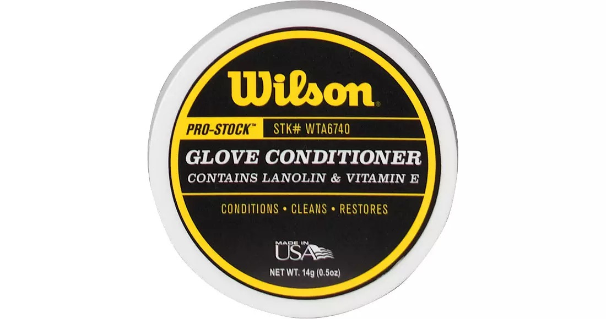
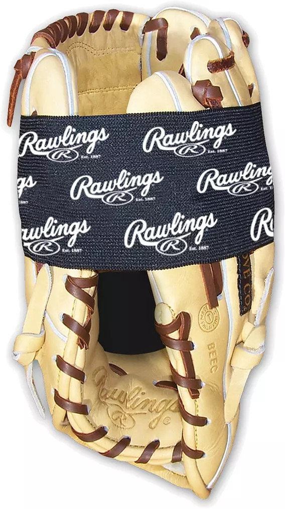
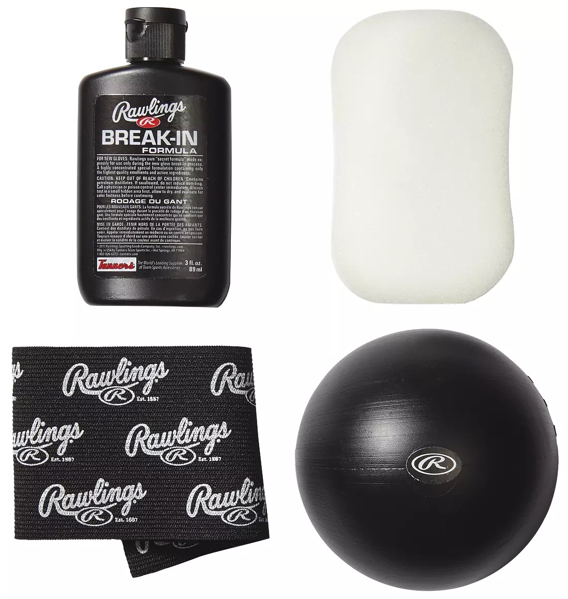

Taking care of a baseball glove doesn’t have to mean buying a bag full of accessories. The useful purchase is the one that fills a need: replacing conditioner, adding a shaping strap, or getting supplies for a new glove.

We compared three options listed at Dick’s Sporting Goods to help you choose. They serve different purposes, and you probably don’t need all three.

\*Disclosure: This article contains affiliate links. We may earn a commission from qualifying purchases, at no additional cost to you.\*

\*Our selections are based on manufacturer information and retailer listings, rather than hands-on testing. Prices and availability may change. Shipping and taxes are additional.\*

 Quick Comparison

\| Product | Listed price at Dick’s | Who should consider it? |

[\| Wilson Pro Stock Glove Conditioner | $14.99 | Players who need a standalone treatment |](https://www.dpbolvw.net/click-101620676-17023985?url=https%3A%2F%2Fwww.dickssportinggoods.com%2Fp%2Fwilson-pro-stock-glove-conditioner-16wiluprstckglvcngcaa%2F16wiluprstckglvcngcaa%3Fcolor%3D)

[\| Rawlings Glove Wrap | $8.99 | Players who only need a shaping strap |](https://www.dpbolvw.net/click-101620676-17023985?url=https%3A%2F%2Fwww.dickssportinggoods.com%2Fp%2Frawlings-glove-wrap-18rawurwlngsglvwrgca%2F18rawurwlngsglvwrgca)

[\| Rawlings Glove Break-In Kit | $19.99 | Players starting without the included supplies |](https://www.tkqlhce.com/click-101620676-17023985?url=https%3A%2F%2Fwww.dickssportinggoods.com%2Fp%2Frawlings-glove-break-in-kit-16rawuglvbrknktxxgca%2F16rawuglvbrknktxxgca)

These are separate buying options—not a checklist of everything a glove owner must purchase.

### [1. Wilson Pro Stock Glove Conditioner](https://www.dpbolvw.net/click-101620676-17023985?url=https%3A%2F%2Fwww.dickssportinggoods.com%2Fp%2Fwilson-pro-stock-glove-conditioner-16wiluprstckglvcngcaa%2F16wiluprstckglvcngcaa%3Fcolor%3D)

Our choice for: Replacing a standalone conditioner\*\*

If you already have your shaping accessories, a separate conditioner may be the only product worth considering.

Dick’s describes Wilson Pro Stock Glove Conditioner as a compact glove-care product containing lanolin and vitamin E. Before applying it, check your glove manufacturer’s recommendations, particularly if the glove includes synthetic materials or a finish with specific care requirements.

We would consider this product when a player needs conditioner and it is compatible with their glove. Buying a complete kit just to replace one care product may leave you with duplicate accessories.

Listed price: $14.99\*\*

\*\*What to check:\*\* Read the application directions on the exact product you buy. Don’t assume more treatment means better results.

\*\*When to skip it:\*\* You already own a suitable treatment, or your glove manufacturer recommends something different.

[\*\*Shop Wilson Pro Stock Glove Conditioner at Dick’s Sporting Goods.\*\*](https://www.dpbolvw.net/click-101620676-17023985?url=https%3A%2F%2Fwww.dickssportinggoods.com%2Fp%2Fwilson-pro-stock-glove-conditioner-16wiluprstckglvcngcaa%2F16wiluprstckglvcngcaa%3Fcolor%3D)

### [2. Rawlings Glove Wrap](https://www.dpbolvw.net/click-101620676-17023985?url=https%3A%2F%2Fwww.dickssportinggoods.com%2Fp%2Frawlings-glove-wrap-18rawurwlngsglvwrgca%2F18rawurwlngsglvwrgca)

Our choice for: Adding a shaping strap without buying another kit\*\*

The Rawlings Glove Wrap is a one-piece elastic strap. Rawlings describes it as an accessory that helps form the glove’s pocket during break-in or reshaping.

This is the focused purchase for someone who already has the other supplies they intend to use. There is no need to buy another bottle of treatment simply to get a strap.

Follow the wrap’s instructions and work with the pocket shape you want. A wrap is a shaping accessory; it should not be treated as a fix for damaged leather or broken laces.

\*\*Listed price: $8.99\*\*

\*\*What to check:\*\* Whether your existing setup already includes a usable strap.

\*\*When to skip it:\*\* You’re choosing the Rawlings Break-In Kit below, which already includes a strap.

[\*\*Shop the Rawlings Glove Wrap at Dick’s Sporting Goods.\*\*](https://www.dpbolvw.net/click-101620676-17023985?url=https%3A%2F%2Fwww.dickssportinggoods.com%2Fp%2Frawlings-glove-wrap-18rawurwlngsglvwrgca%2F18rawurwlngsglvwrgca)

### [3. Rawlings Glove Break-In Kit](https://www.tkqlhce.com/click-101620676-17023985?url=https%3A%2F%2Fwww.dickssportinggoods.com%2Fp%2Frawlings-glove-break-in-kit-16rawuglvbrknktxxgca%2F16rawuglvbrknktxxgca)

\*\*Our choice for: Starting without shaping supplies\*\*

The Rawlings Glove Break-In Kit includes a strap, an oversized ball, Glovolium Break-In Formula, an applicator sponge, and instructions.

The bundle makes the most sense when you actually need those components. Compare its contents with what you already own before deciding whether to buy it instead of individual accessories.

We would consider it for someone preparing a new glove who wants the included tools together. Before applying the formula, check that it matches the glove manufacturer’s care guidance.

\*\*Listed price: $19.99\*\*

\*\*What to check:\*\* The contents of the exact package you’re buying and whether you need the included treatment.

\*\*When to skip it:\*\* You already have a strap, shaping ball, and suitable treatment—or your broken-in glove only needs routine maintenance.

The name “break-in kit” is not a guarantee that a glove will be ready for competition immediately.

[\*\*Shop the Rawlings Glove Break-In Kit at Dick’s Sporting Goods.\*\*](https://www.tkqlhce.com/click-101620676-17023985?url=https%3A%2F%2Fwww.dickssportinggoods.com%2Fp%2Frawlings-glove-break-in-kit-16rawuglvbrknktxxgca%2F16rawuglvbrknktxxgca)

 What Would We Buy?

If you only need conditioner: Choose a compatible standalone product.

If you only need a strap: [Consider the Rawlings Glove Wrap.](https://www.dpbolvw.net/click-101620676-17023985?url=https%3A%2F%2Fwww.dickssportinggoods.com%2Fp%2Frawlings-glove-wrap-18rawurwlngsglvwrgca%2F18rawurwlngsglvwrgca)

If you’re starting without supplies:  Compare the [Rawlings kit’s contents](https://www.tkqlhce.com/click-101620676-17023985?url=https%3A%2F%2Fwww.dickssportinggoods.com%2Fp%2Frawlings-glove-break-in-kit-16rawuglvbrknktxxgca%2F16rawuglvbrknktxxgca) with your needs.

If you already own everything: Keep using your existing supplies. Duplicate purchases won’t make the routine better.

 Care Matters More Than Buying More

Always follow the instructions for your particular glove.

Rawlings recommends storing its fielding gloves in a cool, dry location away from direct sunlight, with a ball in the pocket. It advises applying treatment lightly rather than saturating the glove. Its warranty also excludes heated and over-oiled gloves.

Keep the routine simple: use compatible products as directed, store the glove properly, and avoid aggressive shortcuts. The goal is to care for the glove you own—not collect accessories you won’t use.