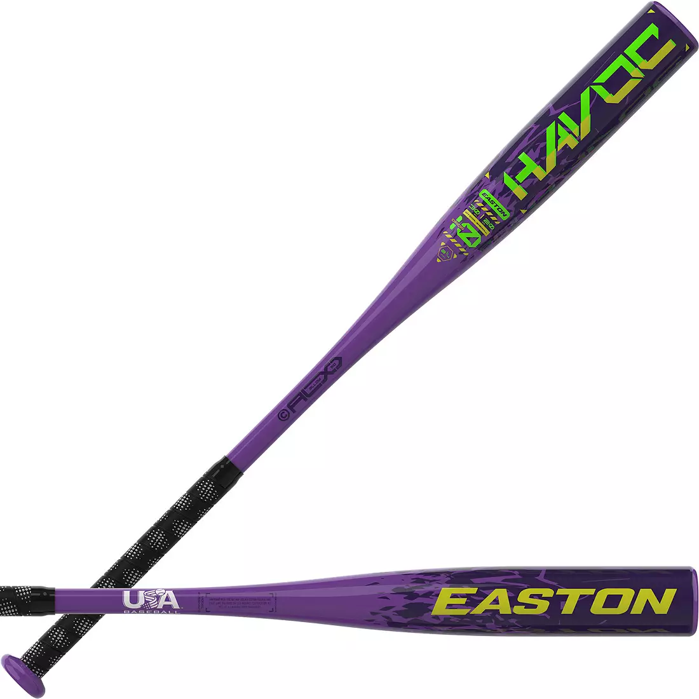
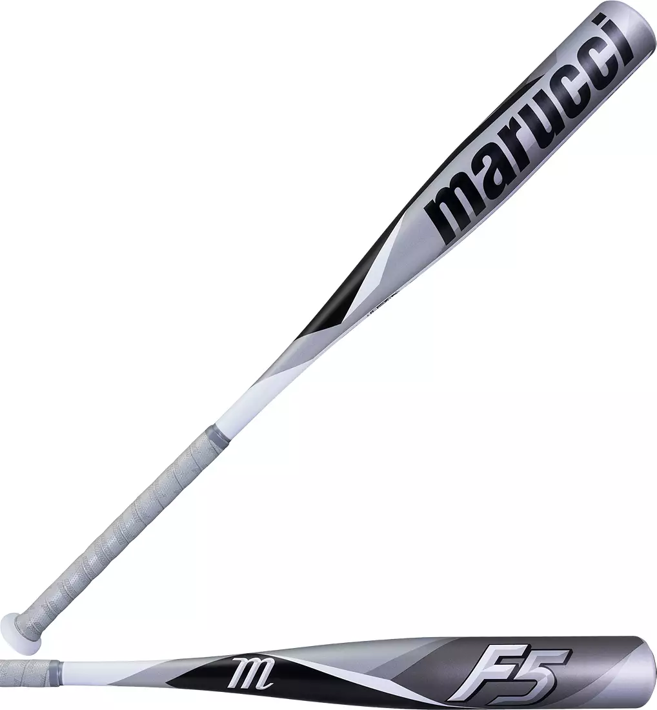
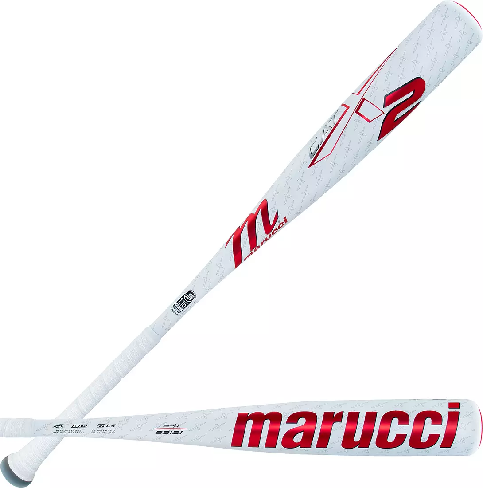
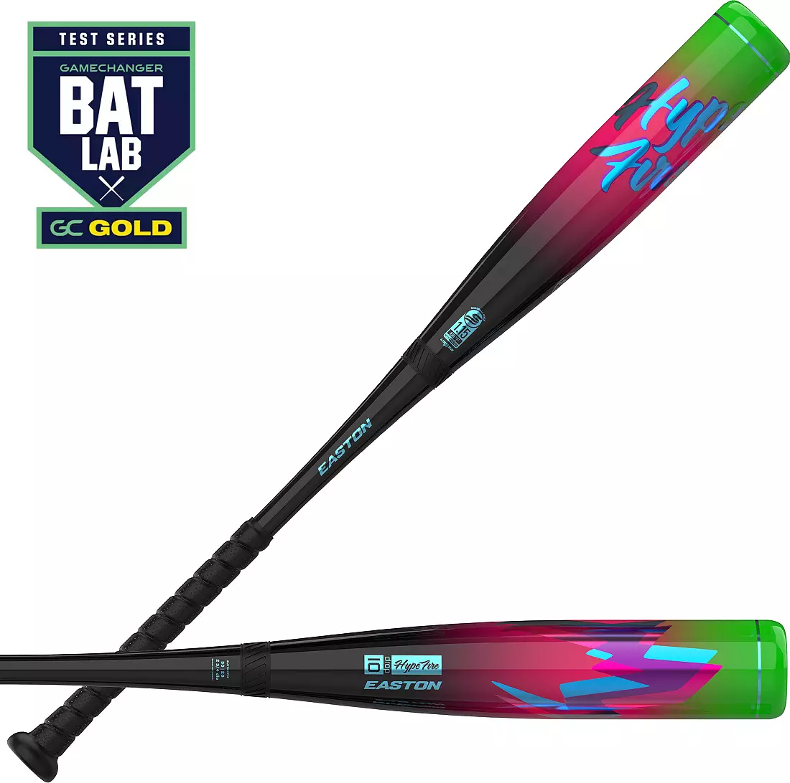

\*Elite Baseball Supply may earn a commission if you buy through affiliate links on this page, at no extra cost to you.\*

A $60 youth bat can be the right buy for a player who’s still growing. A $400 bat can make sense for a travel-ball player who knows what length and weight work for them. Start by asking your coach which bat stamp your division requires. Then shop by fit and budget.

\## Quick picks

[\- \*\*First USA Baseball bat\*\* — Easton Havoc USA (-10), about $60.](https://www.kqzyfj.com/click-101620676-17023985?url=https%3A%2F%2Fwww.dickssportinggoods.com%2Fp%2Feaston-havoc-usa-youth-bat-10-25easbbasehvc10s20tbe%2F25easbbasehvc10s20tbe)

[\- \*\*Budget USSSA bat\*\* — Marucci F5 USSSA (-10), about $120.](https://www.dpbolvw.net/click-101620676-17023985?url=https%3A%2F%2Fwww.dickssportinggoods.com%2Fp%2Fmarucci-f5-23-4-usssa-bat-10-21mccyf523410sss2bbb%2F21mccyf523410sss2bbb)

[\- \*\*Midrange USSSA bat\*\* — Marucci CATX2 Alloy USSSA (-10), seen around $150 on sale.](https://www.jdoqocy.com/click-101620676-17023985?url=https%3A%2F%2Fwww.dickssportinggoods.com%2Fp%2Fmarucci-catx-2-alloy-23-4-usssa-bat-2025-10-24mccbctx2lly1023bbb%2F24mccbctx2lly1023bbb)

[\- \*\*Premium USSSA bat\*\* — 2027 Easton Hype Fire USSSA (-10), about $400.](https://www.kqzyfj.com/click-101620676-17023985?url=https%3A%2F%2Fwww.dickssportinggoods.com%2Fp%2Feaston-hype-fire-usssa-bat-2027-10-26easbbaseua7dukilyd0%2F26easbbaseua7dukilyd0%3Fcjdata%3DMXxOfDB8WXww%26camp%3DAFF%3Amediapartner%3ATEXT_link%3A%3A7826100%3AElite%2520Baseball%2520Supply%2520LLC%26cjevent%3Dc33fdae1e3b311f180cc00090a82b832)

Prices are reference points from DICK’S Sporting Goods. Check the exact size, current price, and availability before ordering.

### \## USA Baseball pick

#### [\### Easton Havoc USA (-10) — about $60](https://www.kqzyfj.com/click-101620676-17023985?url=https%3A%2F%2Fwww.dickssportinggoods.com%2Fp%2Feaston-havoc-usa-youth-bat-10-25easbbasehvc10s20tbe%2F25easbbasehvc10s20tbe)

Start here if your league requires a USA Baseball stamp and your player is buying their first game bat or may outgrow it soon. The Havoc is a balanced, one-piece alloy model. If your player can comfortably swing the right length, this is where I’d start before spending more.

[Check the Easton Havoc USA at Dicks](https://www.kqzyfj.com/click-101620676-17023985?url=https%3A%2F%2Fwww.dickssportinggoods.com%2Fp%2Feaston-havoc-usa-youth-bat-10-25easbbasehvc10s20tbe%2F25easbbasehvc10s20tbe)

### USSSA picks

#### [\### Marucci F5 USSSA (-10) — about $120](https://www.dpbolvw.net/click-101620676-17023985?url=https%3A%2F%2Fwww.dickssportinggoods.com%2Fp%2Fmarucci-f5-23-4-usssa-bat-10-21mccyf523410sss2bbb%2F21mccyf523410sss2bbb)

The F5 is the first bat I’d price for a family entering travel ball on a budget. Look for the 2¾-inch USSSA model and confirm the stamp on the listing. Marucci also sells an F5 with a USA Baseball stamp, so check which version is in your cart.

[Find the Marucci F5 USSSA at DICK'S](https://www.dpbolvw.net/click-101620676-17023985?url=https%3A%2F%2Fwww.dickssportinggoods.com%2Fp%2Fmarucci-f5-23-4-usssa-bat-10-21mccyf523410sss2bbb%2F21mccyf523410sss2bbb)

### [Marucci CATX2 Alloy USSSA (-10) — worth comparing on sale](https://www.jdoqocy.com/click-101620676-17023985?url=https%3A%2F%2Fwww.dickssportinggoods.com%2Fp%2Fmarucci-catx-2-alloy-23-4-usssa-bat-2025-10-24mccbctx2lly1023bbb%2F24mccbctx2lly1023bbb)

Put the alloy CATX2 next to the F5 if you find it around $150 in the right size. The CATX2 listing specifies a molded handle taper, so pay attention to how it sits in your player’s hands if they can hold both. If the sale is gone and your player likes the F5, I’d save the money.

[Check the Marucci CATX2 Alloy USSSA at Dicks](https://www.jdoqocy.com/click-101620676-17023985?url=https%3A%2F%2Fwww.dickssportinggoods.com%2Fp%2Fmarucci-catx-2-alloy-23-4-usssa-bat-2025-10-24mccbctx2lly1023bbb%2F24mccbctx2lly1023bbb)

### [2027 Easton Hype Fire USSSA (-10) — about $400](https://www.kqzyfj.com/click-101620676-17023985?url=https%3A%2F%2Fwww.dickssportinggoods.com%2Fp%2Feaston-hype-fire-usssa-bat-2027-10-26easbbaseua7dukilyd0%2F26easbbaseua7dukilyd0%3Fcjdata%3DMXxOfDB8WXww%26camp%3DAFF%3Amediapartner%3ATEXT_link%3A%3A7826100%3AElite%2520Baseball%2520Supply%2520LLC%26cjevent%3Dc33fdae1e3b311f180cc00090a82b832)

Consider the Hype Fire if your player competes regularly, already knows their size, and wants a two-piece composite bat. Around $400 is a big commitment if they’re likely to need a heavier or longer bat soon. The same Hype Fire name appears on multiple versions, so confirm you’re looking at the standard USSSA model in the right drop.

[Check the 2027 Easton Hype Fire USSSA at Dicks ](https://www.kqzyfj.com/click-101620676-17023985?url=https%3A%2F%2Fwww.dickssportinggoods.com%2Fp%2Feaston-hype-fire-usssa-bat-2027-10-26easbbaseua7dukilyd0%2F26easbbaseua7dukilyd0%3Fcjdata%3DMXxOfDB8WXww%26camp%3DAFF%3Amediapartner%3ATEXT_link%3A%3A7826100%3AElite%2520Baseball%2520Supply%2520LLC%26cjevent%3Dc33fdae1e3b311f180cc00090a82b832)

[Read our full 2027 Easton Hype Fire USSSA review ](https://elitebaseballsupply.com/pages/blog/2027-easton-hype-fire-usssa-review-is-it-worth-399-99/)

Three things to check before you order

1. \*\*Confirm the stamp and drop.\*\* Ask your coach or tournament director about the exact division your player will enter. Bat rules can vary.

2. \*\*Compare at the same length.\*\* A 30-inch drop-10 bat is listed at 20 ounces. A 30-inch drop-8 is listed at 22 ounces. If your player can try both, watch whether they can repeat a controlled swing without slowing down or dropping the barrel.

3. \*\*Check the return policy before hitting balls.\*\* Confirm the retailer’s terms for the exact bat, especially if it’s discounted.

If I were buying a first USA Baseball bat, I’d start with the Havoc. If the team requires USSSA, I’d start with the F5 and only move up in price once my player knows what they want from a bat.