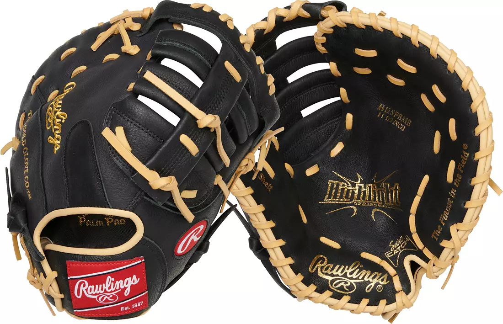

Your child played first base last Saturday, and now you’re wondering if they need a new glove. If they only play there occasionally and can catch comfortably with their current glove, I’d hold off. If they’re starting at first most games, a dedicated mitt is worth trying.

Here’s what changes when you switch to a first base mitt, plus two options to compare at DICK’S Sporting Goods.

### What does a first base mitt do differently?

A first base mitt has a rounded shape and a longer catching surface than a typical infield glove. That shape gives your player a bigger target to show teammates and more room to receive throws that arrive low or a little off line. A regular fielding glove is more versatile for a player who also spends time at shortstop, second base, or in the outfield. [DICK’S baseball glove buying guide](https://www.kqzyfj.com/click-101620676-17023985?url=https%3A%2F%2Fwww.dickssportinggoods.com%2Frc%2Fbaseball-glove-buying-guide)

Think about where they’ll play over the next few weeks. If their coach is still rotating everyone, the glove they already use may cover the job. If first base has become their regular position, have them try a mitt before buying.

### [Rawlings Highlight 11.5-Inch — The first mitt I’d try for a smaller player](https://www.kqzyfj.com/click-101620676-17023985?url=https%3A%2F%2Fwww.dickssportinggoods.com%2Fp%2Frawlings-11-5-youth-highlight-series-first-base-mitt-2023-22rawyhghlght1151bgl%2F22rawyhghlght1151bgl)

Start with the Rawlings Youth Highlight if your child is new to first base or already finds larger gloves hard to control. The 11.5-inch size gives them a shorter option to try before moving up to a longer mitt.

Have your player put it on, show a target, and close it around a baseball with one hand. Then have them reach down as if they’re receiving a low throw. If the mitt stays secure and they can close it comfortably, you’ve found a good starting point.

[Shop the Rawlings 11.5-Inch Youth Highlight First Base Mitt at DICK’S](https://www.kqzyfj.com/click-101620676-17023985?url=https%3A%2F%2Fwww.dickssportinggoods.com%2Fp%2Frawlings-11-5-youth-highlight-series-first-base-mitt-2023-22rawyhghlght1151bgl%2F22rawyhghlght1151bgl)

### [Mizuno Franchise 12.5-Inch — For a regular first baseman who wants more reach](https://www.dpbolvw.net/click-101620676-17023985?url=https%3A%2F%2Fwww.dickssportinggoods.com%2Fp%2Fmizuno-12-5-franchise-series-first-base-mitt-24mizafrnchs1b125fpg%2F24mizafrnchs1b125fpg%3Fcolor%3DTan%252FBlack)

Try the Mizuno Franchise if your player starts at first regularly and can handle a longer mitt. I’d have them try it on before buying, especially if they’re coming from a shorter youth glove. The extra length helps only if they can move the mitt quickly and close it around the ball.

If you can play catch before deciding, mix in a few gentle low throws. Watch whether your player can turn the mitt down, receive the ball, and bring it back without the mitt shifting on their hand.

[Shop the Mizuno 12.5-Inch Franchise First Base Mitt at DICK’S](https://www.dpbolvw.net/click-101620676-17023985?url=https%3A%2F%2Fwww.dickssportinggoods.com%2Fp%2Fmizuno-12-5-franchise-series-first-base-mitt-24mizafrnchs1b125fpg%2F24mizafrnchs1b125fpg%3Fcolor%3DTan%252FBlack)

The quick decision before you buy

\- They rotate through several positions. Keep using their current fielding glove if it fits and they catch comfortably with it.

\- They’re a smaller player starting to play first regularly. Try the 11.5-inch Rawlings first.

\- They play first most games and want more reach. Compare the 12.5-inch Mizuno with a shorter mitt and buy whichever they control better.

Before ordering, check the throwing-hand option. A right-hand thrower wears the mitt on their left hand.