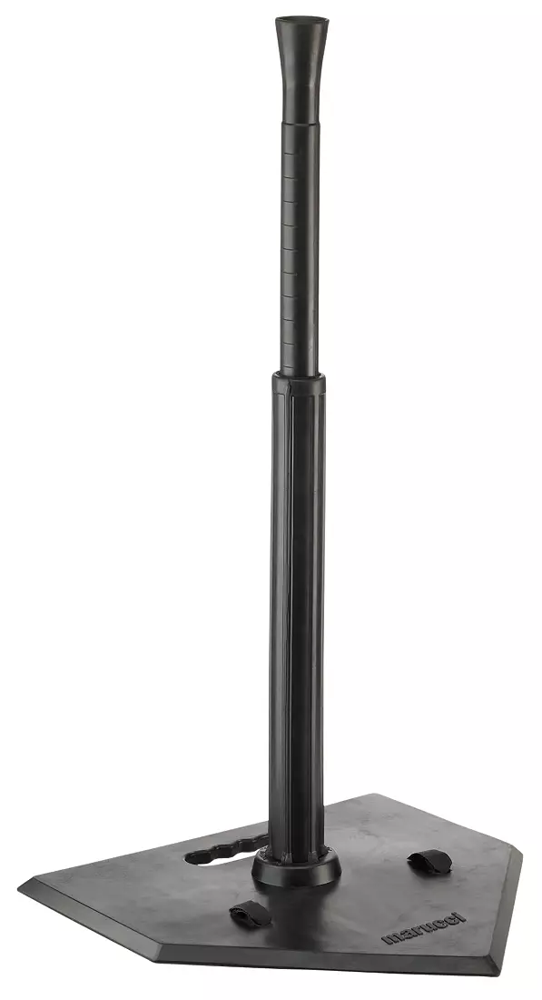
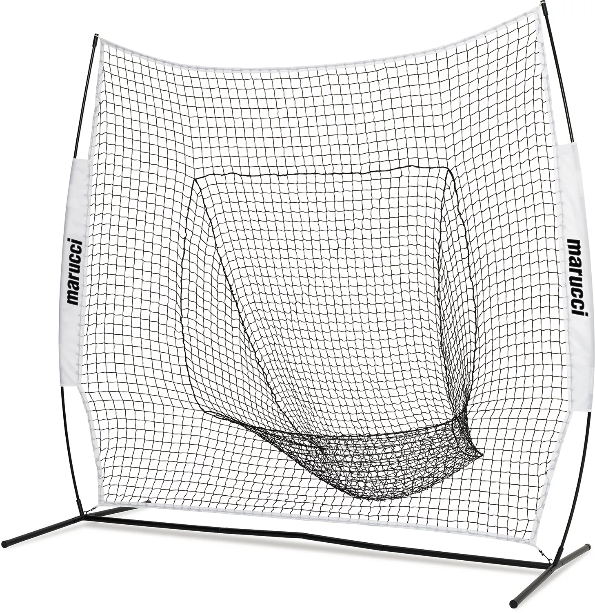

A home batting practice setup starts with two different jobs: holding the ball where you want to hit it and providing a target for your contact.

A batting tee handles the first job. A hitting net handles the second. They work together, but you may only need one if you already own part of the setup.

Here’s a closer look at the[ Marucci 1 Position Full Rubber Batting Tee](https://www.jdoqocy.com/click-101620676-17023985?url=https%3A%2F%2Fwww.dickssportinggoods.com%2Fp%2Fmarucci-1-position-full-rubber-batting-tee-23mccu1pstnfllrbbbas%2F23mccu1pstnfllrbbbas) and [Marucci 7′ Instant Net with Big Pocket](https://www.kqzyfj.com/click-101620676-17023985?url=https%3A%2F%2Fwww.dickssportinggoods.com%2Fp%2Fmarucci-7-instant-net-w-big-pocket-22mccu7nstntntxxxbas%2F22mccu7nstntntxxxbas), both sold at [Dick’s Sporting Goods](https://www.jdoqocy.com/click-101620676-17023985).

\*Disclosure: This article contains affiliate links. We may earn a commission from qualifying purchases, at no additional cost to you.\*

\*This guide is based on retailer specifications rather than hands-on testing. Prices and availability may change. Shipping and taxes are additional.

### [\## Marucci 1 Position Full Rubber Batting Tee](https://www.jdoqocy.com/click-101620676-17023985?url=https%3A%2F%2Fwww.dickssportinggoods.com%2Fp%2Fmarucci-1-position-full-rubber-batting-tee-23mccu1pstnfllrbbbas%2F23mccu1pstnfllrbbbas)

\*\*Consider it if: You need a straightforward tee or already own a suitable net.\*\*

This Marucci tee adjusts from \*\*22 to 35 inches\*\*, allowing you to change the ball’s height within that range. Check those measurements against the player’s intended practice positions before ordering.

Dick’s lists a heavy rubber plate for stability, rubber teeth that lock the tee in place, and a grooved design intended to reduce shifting during swings.

The tee also retracts into itself for storage and includes a carry handle. Those features are worth considering if your equipment needs to move between home and the field.

\*\*What we like about the design:\*\* Adjustable height and a storage arrangement that keeps the pieces together.

\*\*What to consider:\*\* This is a one-position tee. To change where the ball sits relative to the hitter, you’ll reposition the tee or adjust your stance rather than select another mounting point on the base.

\*\*Price shown when checked: $34.99\*\*

[\*\*Shop the Marucci 1 Position Full Rubber Batting Tee at Dick’s Sporting Goods.\*\*](https://www.jdoqocy.com/click-101620676-17023985?url=https%3A%2F%2Fwww.dickssportinggoods.com%2Fp%2Fmarucci-1-position-full-rubber-batting-tee-23mccu1pstnfllrbbbas%2F23mccu1pstnfllrbbbas)

### [\## Marucci 7′ Instant Net with Big Pocket](https://www.kqzyfj.com/click-101620676-17023985?url=https%3A%2F%2Fwww.dickssportinggoods.com%2Fp%2Fmarucci-7-instant-net-w-big-pocket-22mccu7nstntntxxxbas%2F22mccu7nstntntxxxbas)

\*\*Consider it if: You already have a tee or want a net for hitting and throwing practice.\*\*

Dick’s lists this 7-foot net for hitting, pitching, and throwing drills. Its large pocket collects balls, which can make retrieval more convenient between rounds.

The listed construction includes composite poles and a metal base. Ground stakes and a carry bag are included, and its listed carry weight is \*\*13 pounds\*\*.

For someone who packs equipment away after each session, the carry bag is a useful feature. The weight is also worth considering if a younger player will be responsible for moving the equipment.

\*\*What we like about the design:\*\* A collection pocket and included storage bag make it a practical option to compare for a portable setup.

\*\*What to consider:\*\* “7-foot net” does not mean a seven-foot space is enough for batting practice. You also need room for the frame, the hitter’s full swing, the intended hitting distance, and a clear surrounding area.

\*\*Price shown when checked: $99.99 on sale; listed regular price $119.99\*\*

[\*\*Shop the Marucci 7′ Instant Net with Big Pocket at Dick’s Sporting Goods.\*\*](https://www.kqzyfj.com/click-101620676-17023985?url=https%3A%2F%2Fwww.dickssportinggoods.com%2Fp%2Fmarucci-7-instant-net-w-big-pocket-22mccu7nstntntxxxbas%2F22mccu7nstntntxxxbas)

\## Do You Need Both?

\*\*Buy the tee only if\*\* you already have a suitable net or access to an appropriate batting practice area.

\*\*Buy the net only if\*\* your current tee already fits the player and works properly.

\*\*Consider both if\*\* you’re starting without either piece and have enough space to follow the equipment’s setup and use instructions.

There’s no reason to replace equipment that already does the job. Put your budget toward the missing piece.

\## Check Your Space Before Ordering

Measure the practice area first. Check the net’s assembled dimensions and setup instructions rather than relying only on the product name.

Allow room for the entire swing, including the bat’s follow-through. Keep other people, pets, vehicles, windows, and breakable objects out of the hitting area and possible ball paths.

An open-face practice net is not a fully enclosed batting cage. Misses can travel around or over it. Inspect the net and frame before use, secure it as directed, and use only balls approved for the equipment.

For children, have an adult supervise setup and practice. Don’t assume a garage or basement is suitable simply because the equipment physically fits.

\## What Else Do You Need?

Before your first session, check that you have:

\- An appropriate bat and compatible practice balls.

\- Enough clearance for the hitter and equipment.

\- Any required protective equipment.

\- The manufacturer’s setup and use instructions.

A tee-and-net purchase does not automatically include bats or balls. Confirm the contents of each listing before checkout.

\## Our Buying Takeaway

[The Marucci tee ](https://www.jdoqocy.com/click-101620676-17023985?url=https%3A%2F%2Fwww.dickssportinggoods.com%2Fp%2Fmarucci-1-position-full-rubber-batting-tee-23mccu1pstnfllrbbbas%2F23mccu1pstnfllrbbbas)is the lower-cost starting point for someone who already has somewhere suitable to hit. [The Marucci pocket](https://www.kqzyfj.com/click-101620676-17023985?url=https%3A%2F%2Fwww.dickssportinggoods.com%2Fp%2Fmarucci-7-instant-net-w-big-pocket-22mccu7nstntntxxxbas%2F22mccu7nstntntxxxbas) net is the complementary purchase for someone who needs a practice target and ball collection.

If you need both, compare the combined price with your budget—but make space and suitability the first decision. A useful home setup is one you can assemble correctly, use responsibly, and return to consistently.