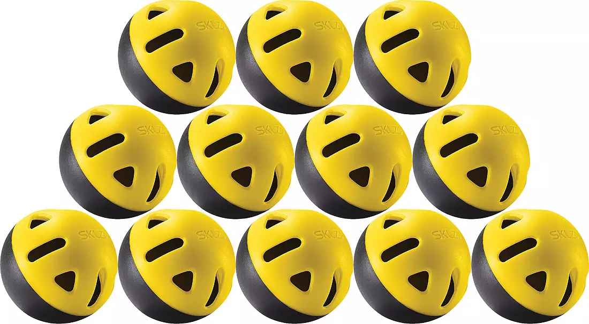
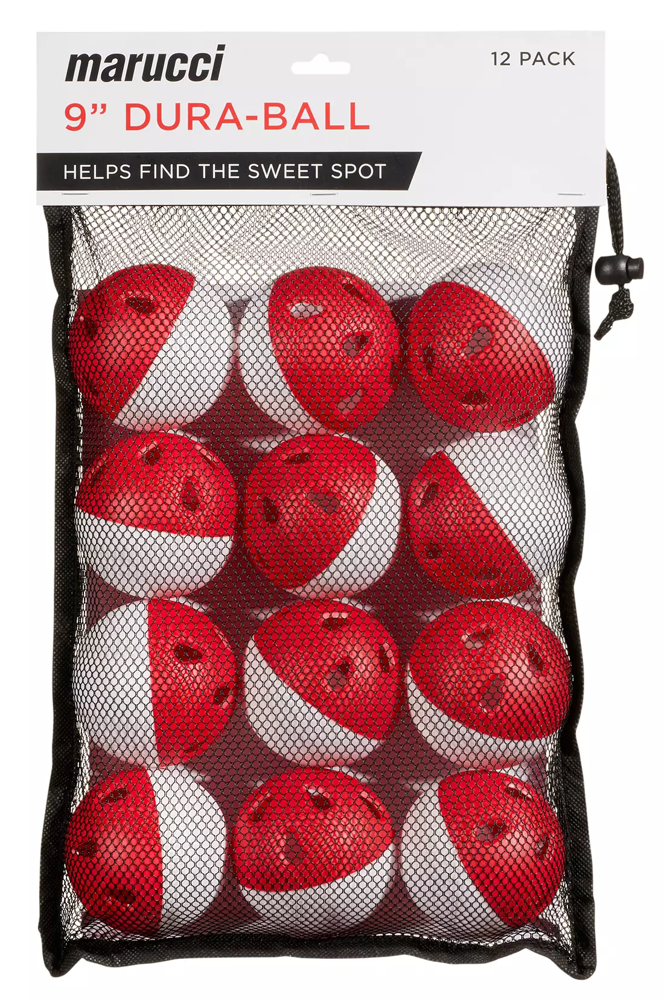
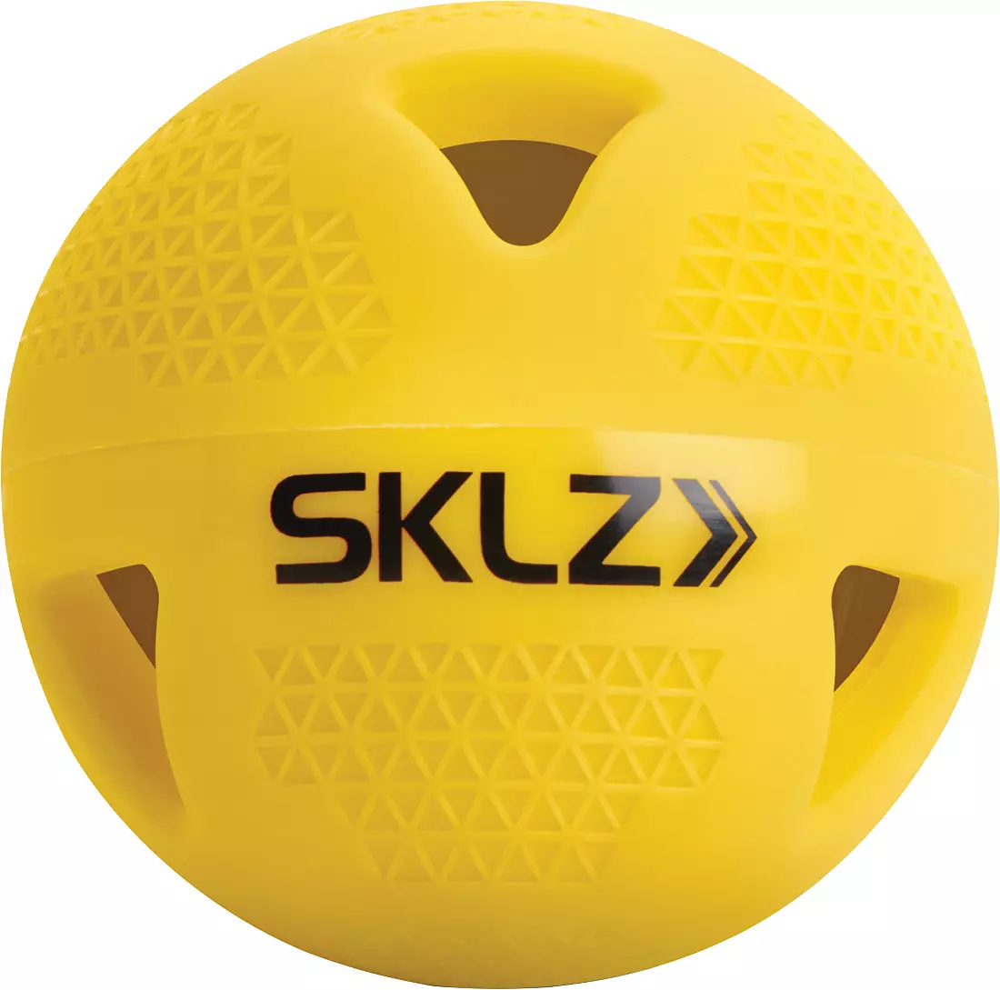

You’ve got a batting tee and enough room to swing. But do you have enough room for what happens after contact?

For most backyard sessions, I’d start with a lightweight impact practice ball. It lets a young hitter take swings without sending a regulation baseball across the yard every time they make solid contact. The right pick depends on how much space you have, whether you use a net, and how many swings you want to get in before collecting balls.

### [1. SKLZ Impact Practice Balls, 12-Pack — Start here for tee work](https://www.tkqlhce.com/click-101620676-17023985?url=https%3A%2F%2Fwww.dickssportinggoods.com%2Fp%2Fsklz-impact-practice-balls-12-pack-16slzumpctprctcbstra%2F16slzumpctprctcbstra)

If your player is working on making consistent contact, start with this pack. Set up the tee, put a handful of balls within reach, and have them hit a short round before stopping to collect anything. A dozen balls is enough to get several swings in a row and still keep cleanup manageable.

Try this drill: Set the tee at waist height and give your player five swings to hit toward the middle of the net. Then move the tee lower and repeat. Keep the target the same so they can see whether they’re making clean contact at both heights. 

[Shop the SKLZ Impact Practice Balls 12-pack at DICK’S](https://www.tkqlhce.com/click-101620676-17023985?url=https%3A%2F%2Fwww.dickssportinggoods.com%2Fp%2Fsklz-impact-practice-balls-12-pack-16slzumpctprctcbstra%2F16slzumpctprctcbstra)

### [2. Marucci 9-Inch Dura-Ball Impact Training Baseballs, 12-Pack — For a familiar target](https://www.tkqlhce.com/click-101620676-17023985?url=https%3A%2F%2Fwww.dickssportinggoods.com%2Fp%2Fmarucci-9-dura-ball-impact-training-baseballs-12-pack-23mccumrccmpctbllbas%2F23mccumrccmpctbllbas)

Try the Dura-Balls if your player wants a baseball-size target for tee work. The 9-inch measurement refers to the ball’s circumference, so it gives the hitter a familiar size to track as they set up and swing. With 12 in the pack, you can run a few quick rounds with two players taking turns.

Try this drill: Start with the tee over the middle of the plate. For the next round, move it to the outside part of the plate and slightly farther back. Have your hitter aim toward the opposite side of the net. 

[Shop the Marucci Dura-Ball 12-pack at DICK’S](https://www.tkqlhce.com/click-101620676-17023985?url=https%3A%2F%2Fwww.dickssportinggoods.com%2Fp%2Fmarucci-9-dura-ball-impact-training-baseballs-12-pack-23mccumrccmpctbllbas%2F23mccumrccmpctbllbas)

### [3. SKLZ Premium Impact Baseballs, 6-Pack — For short rounds into a net](https://www.kqzyfj.com/click-101620676-17023985?url=https%3A%2F%2Fwww.dickssportinggoods.com%2Fp%2Fsklz-premium-impact-baseballs-6-pack-19slzuprmmmpctbsbtra%2F19slzuprmmmpctbsbtra)

Six balls can be plenty if your player already has a net and likes to work on one thing at a time. Hit one round, collect the balls, then change the tee height or pick a new target. I’d choose the 12-pack if you’d rather spend less time collecting between rounds.

Try this drill: Give your hitter six swings and ask them to count how many balls hit the center of the net. Repeat and see if they can beat their first round.

[Shop the SKLZ Premium Impact Baseballs 6-pack at DICK’S](https://www.kqzyfj.com/click-101620676-17023985?url=https%3A%2F%2Fwww.dickssportinggoods.com%2Fp%2Fsklz-premium-impact-baseballs-6-pack-19slzuprmmmpctbsbtra%2F19slzuprmmmpctbsbtra)

Do you still need a net?

I’d use one if the yard is small or there are windows, cars, or neighbors nearby. A shorter-flight ball can still leave the yard on a hard swing. Check what’s behind and alongside your hitting area, and keep everyone clear of the bat and the path of the ball. If you also need a tee or net, start with our [home batting practice setup guide](https://elitebaseballsupply.com/pages/blog/home-baseball-batting-practice-setup-a-tee-and-net-buying-guide/).

What I’d buy first

For a young player doing regular tee work at home, I’d buy the [SKLZ Impact Practice Balls 12-pack first.](https://www.tkqlhce.com/click-101620676-17023985?url=https%3A%2F%2Fwww.dickssportinggoods.com%2Fp%2Fsklz-impact-practice-balls-12-pack-16slzumpctprctcbstra%2F16slzumpctprctcbstra) Choose the [Marucci Dura-Balls](https://www.tkqlhce.com/click-101620676-17023985?url=https%3A%2F%2Fwww.dickssportinggoods.com%2Fp%2Fmarucci-9-dura-ball-impact-training-baseballs-12-pack-23mccumrccmpctbllbas%2F23mccumrccmpctbllbas) if your player wants a baseball-size target, or go with [the six-pack](https://www.kqzyfj.com/click-101620676-17023985?url=https%3A%2F%2Fwww.dickssportinggoods.com%2Fp%2Fsklz-premium-impact-baseballs-6-pack-19slzuprmmmpctbsbtra%2F19slzuprmmmpctbsbtra) if you already hit into a net and prefer shorter rounds. Start with one pack and see how often your player actually uses it.